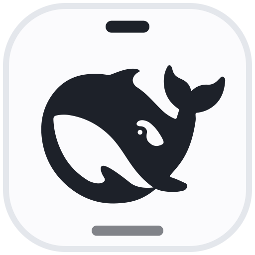
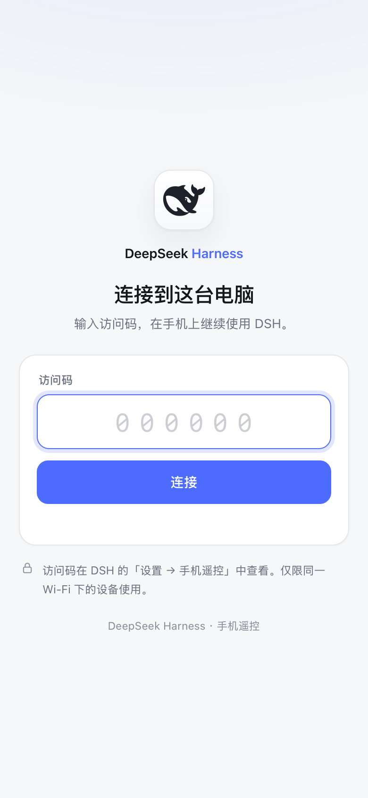
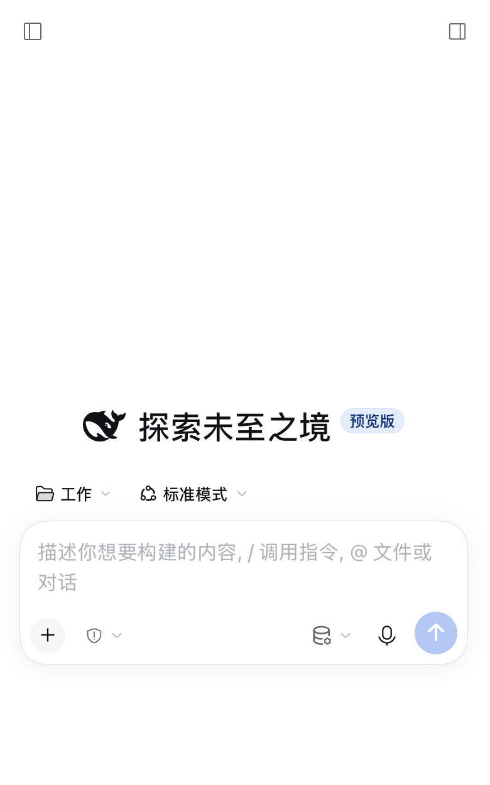
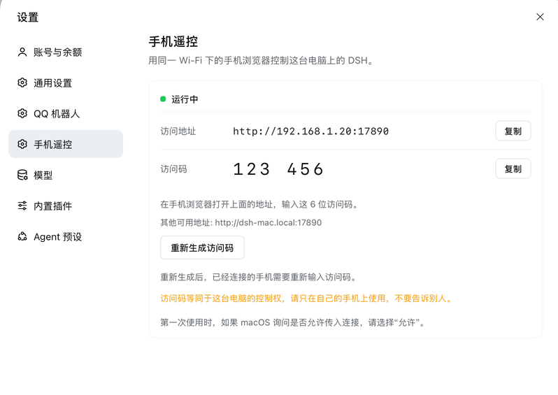

# Phone remote



A DeepSeek Harness plugin that lets a phone on the same Wi-Fi drive the DSH
running on your computer. The phone opens a six-digit sign-in page, and the
normal DSH Web UI follows: the session list, chat, tools, permissions and
settings, all over the local network. There is no cloud relay, no account and
no extra client.

| Sign in on the phone | DSH over the LAN |
|:---:|:---:|
|  |  |



*The screenshots use an example address and access code.*

## How it works

The desktop DSH Web server listens on loopback only and protects its first page
with a per-process launch token. The plugin starts a second HTTP listener on
the local network and keeps the real DSH server as its upstream:

1. The visitor opens the gateway and enters the six-digit access code.
2. On success the gateway asks `ctx.connection.authenticatedUrl()` for a normal
   DSH browser session, relays that cookie to the phone, and sets its own
   signed 30-day gateway cookie.
3. It proxies the page, static assets and the `/api/remote.mux` WebSocket to the
   loopback server, rewriting upstream `Host` and `Origin` to the real loopback
   authority. DSH's browser-trust fence and session authorization therefore
   keep working unchanged.

The phone runs the same Web bundles and UI the desktop shows. The gateway adds
only the LAN listener, the access-code page and the cookie translation; it does
not reimplement sessions, chat or tool execution.

## Install

Add the bundle with the DSH CLI:

```bash
dsh plugin --profile desktop add github:LXD-8/dsh-phone-remote
```

Or clone this repository, link it into the profile, and select the
`@local/dsh-phone-remote` bundle in **Plugins**:

```json
"@local/dsh-phone-remote": "link:/absolute/path/to/dsh-phone-remote"
```

The bundle inserts the `phone-remote` row with `config.port: 17890`. Change the
port in the row's configuration if another service uses it. The plugin needs
the `webServer` and `connection` Host services, so it is meant for a profile
with the Web UI.

## Use

1. Put the phone on the same Wi-Fi as the computer.
2. In DSH, open **Settings → 手机遥控** and copy the address and access code.
3. Open the address in the phone browser and enter the code.
4. Add the page to the home screen if you want an app-like entry.

The settings page also shows the current LAN address, the code and the `.local`
alternative, and can rotate the code. Rotating invalidates the existing gateway
cookies, so every connected phone has to enter the new code.

The access code and the gateway cookie key are generated once and stored in
`$DSH_HOME/phone-remote.json` with mode `0600`. Deleting that file makes the
plugin generate a fresh pair on the next start.

## Security

The access code grants **full DSH control**, including the shell and file tools
available to the agent. Treat it like a password.

- The gateway is **plain HTTP**. Use it on a trusted home or office LAN, not on
  public Wi-Fi. Do not forward the port from the internet.
- The six-digit code is limited to 8 attempts per 10 minutes per client address.
- The gateway cookie is an HMAC-signed, `HttpOnly`, `SameSite=Lax` cookie with a
  30-day lifetime. Rotating the code rotates the signing key and revokes every
  existing phone.
- The listener binds `0.0.0.0:17890` and is reachable from every interface the
  computer has. Disable the plugin (or change the port) when you do not want it
  listening.
- DSH's own session cookie is relayed to the phone. It is scoped to the gateway
  origin in the phone's browser; the gateway always sends the loopback authority
  upstream.

## Requirements and limits

- DSH desktop with the Web UI; tested on macOS against DSH `0.2.2-rc.1`.
- Phone and computer on the same LAN, and port 17890 free.
- Allow incoming connections for DeepSeek Harness in the computer's firewall.
  On macOS, choose **Allow** if the prompt appears.
- The sign-in page is in Chinese.
- The listener is IPv4 (`0.0.0.0`), so an IPv6-only LAN cannot reach it.
- There is no TLS and no built-in QR code; copy the address or use the `.local`
  alternative.
- The phone layout is the shipped DSH Web UI. It was checked at 320×568 and
  390×844 viewports; the shell's own split panes collapse the sidebars there.

## Verification

Checked end to end against DSH `0.2.2-rc.1` on macOS with WebKit at an iPhone
viewport:

- the access-code page and wrong-code error, including the rate limit;
- minting a DSH session and proxying the page, static assets, `/api` calls and
  the `/api/remote.mux` WebSocket (HTTP 101);
- the settings section, the live address and code, and code rotation;
- a port conflict (`EADDRINUSE` reported in the settings state) and recovery
  after the conflicting listener stops.

The phone and settings screenshots are the real UI served through the gateway,
with an example address and code in the documentation image.

## License

MIT
