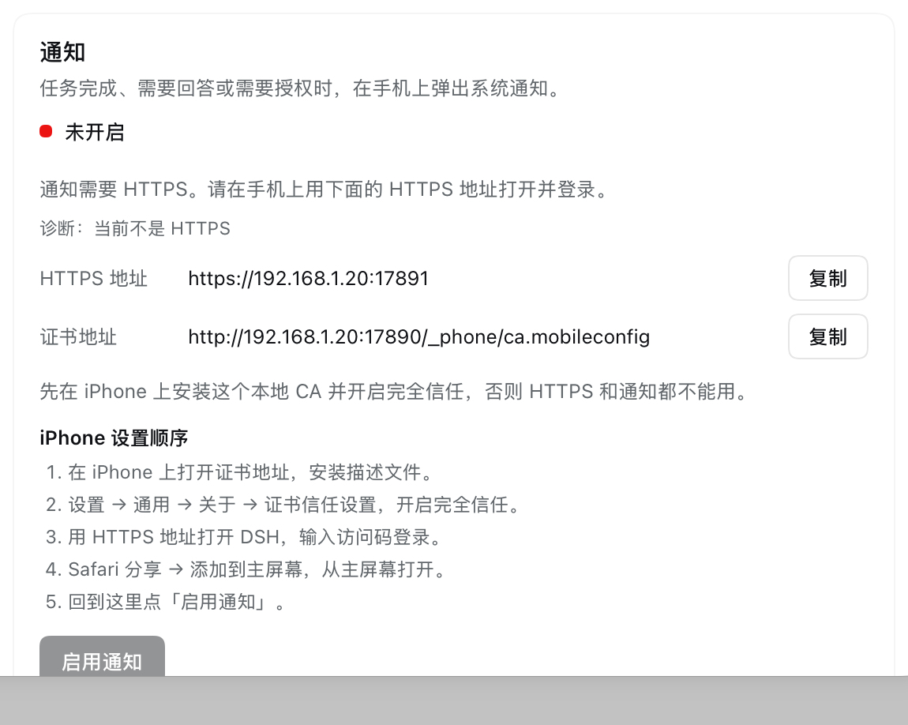

# Phone remote


A DeepSeek Harness plugin that lets a phone on the same Wi-Fi drive the DSH
running on your computer. The phone opens a six-digit sign-in page, and the
normal DSH Web UI follows: the session list, chat, tools, permissions and
settings, all over the local network. The plugin can also raise a real system
notification on the phone when a turn finishes, or when the agent is waiting
for an answer or an approval.

| Sign in on the phone | DSH over the LAN |
|:---:|:---:|
|  |  |




*The screenshots use an example address and access code.*

## How it works

The desktop DSH Web server listens on loopback only and protects its first page
with a per-process launch token. The plugin starts HTTP and HTTPS listeners on
the local network and keeps the real DSH server as its upstream:

1. The visitor opens the gateway and enters the six-digit access code.
2. On success the gateway asks `ctx.connection.authenticatedUrl()` for a normal
   DSH browser session, relays that cookie to the phone, and sets its own
   signed 30-day gateway cookie.
3. It proxies the page, static assets and the `/api/remote.mux` WebSocket to the
   loopback server, rewriting upstream `Host` and `Origin` to the real loopback
   authority. DSH's browser-trust fence and session authorization therefore
   keep working unchanged.

The phone runs the same Web bundles and UI the desktop shows. The gateway adds
only the LAN listeners, the access-code page and the cookie translation; it does
not reimplement sessions, chat or tool execution.

## Push notifications

Web Push needs a **secure context** and a **service worker**. A home LAN has no
public certificate, so the plugin creates a local CA and a server certificate
and serves HTTPS on port `17891` (HTTP stays on `17890`). The phone installs and
trusts that CA once; the server certificate can then rotate on every start.

The plugin also generates a VAPID key pair and stores the phone's
`PushSubscription`. On `turn/end` (completed, error, max-tokens),
`user-questions/request`, and `approval/request`, it sends an encrypted Web Push
through the browser's push service. The service worker shows the notification
and opens the session when it is tapped. A visible, focused DSH page suppresses
the duplicate notification; a test notification bypasses that.

### iPhone setup

1. On the iPhone, open the **certificate address** from
   **Settings → 手机遥控 → 通知** (`http://<lan-ip>:17890/_phone/ca.mobileconfig`),
   and install the profile.
2. Open **Settings → General → About → Certificate Trust Settings** and enable
   full trust for **DSH Phone Remote Local CA**.
3. Open the **HTTPS address** (`https://<lan-ip>:17891/`) and enter the access
   code.
4. In Safari, **Share → Add to Home Screen**, then open the page from the Home
   Screen. iOS 16.4+ only supports Web Push from a Home Screen web app.
5. In **Settings → 手机遥控 → 通知**, tap **Enable notifications**, allow the
   prompt, and use **Send test notification** to verify.

If Safari refuses to download the profile over HTTP, AirDrop
`$DSH_HOME/phone-remote-tls/ca.mobileconfig` from the Mac to the phone and install
it from Files.
The **Enable notifications** button is always visible on the card. It stays
disabled, with a one-line diagnosis, until the page is the phone's HTTPS
gateway, opened from the iPhone Home Screen, and the browser exposes
`PushManager` (iOS 16.4+). On the computer's own DSH settings the button is
disabled by design; use the phone. If the diagnosis says "no Push API", the
iPhone is below iOS 16.4 or the page is not the Home Screen app, and Web Push
cannot be enabled from that context.


Android Chrome needs the certificate (1), the HTTPS page (3), and the enable step
(5); the Home Screen step is not required for Web Push.

The computer must be able to reach the phone's push service (Apple or Google)
over the internet. The notification payload is encrypted by Web Push; the push
service sees delivery metadata, not the notification text. The notification
shows the Session title and a short preview of the answer/question/approval
reason.

## Install

Add the bundle with the DSH CLI:

```bash
dsh plugin --profile desktop add github:LXD-8/dsh-phone-remote
```

Or clone this repository, link it into the profile, and select the
`@local/dsh-phone-remote` bundle in **Plugins**:

```json
"@local/dsh-phone-remote": "link:/absolute/path/to/dsh-phone-remote"
```

When installing from a linked checkout, run `pnpm install` in the plugin
directory first: `web-push` is a runtime dependency.

The bundle inserts the `phone-remote` row with `config.port: 17890` (HTTP) and
`config.httpsPort: 17891` (HTTPS). Change either port in the row's configuration
if another service uses it. The plugin needs the `webServer` and `connection`
Host services, so it is meant for a profile with the Web UI.

## Use

1. Put the phone on the same Wi-Fi as the computer.
2. In DSH, open **Settings → 手机遥控** and copy the address and access code.
3. Open the address in the phone browser and enter the code.
4. Add the page to the home screen if you want an app-like entry.

The settings page shows the HTTP address, the HTTPS address, the certificate
address, the code and the `.local` alternative, and can rotate the code.
Rotating invalidates the existing gateway cookies and clears the registered push
subscriptions, so every phone has to enter the new code and enable notifications
again.

The access code and the gateway cookie key are generated once and stored in
`$DSH_HOME/phone-remote.json` with mode `0600`. The CA and server certificate
live in `$DSH_HOME/phone-remote-tls/`; the VAPID keys and subscriptions live in
`$DSH_HOME/phone-remote-push.json`. Deleting those files makes the plugin
generate fresh material on the next start.

## Security

The access code grants **full DSH control**, including the shell and file tools
available to the agent. Treat it like a password.

- The HTTP listener on `17890` is plain HTTP. The HTTPS listener on `17891` is
  encrypted. Use both only on a trusted home or office LAN. Do not forward
  either port from the internet.
- The local CA private key is in `$DSH_HOME/phone-remote-tls/ca.key`. Anyone
  with that key can sign certificates the phone trusts. Keep it private; delete
  the TLS directory and remove the profile from the phone to rotate it.
- The six-digit code is limited to 8 attempts per 10 minutes per client address.
- The gateway cookie is an HMAC-signed, `HttpOnly`, `SameSite=Lax` cookie with a
  30-day lifetime. On HTTPS it is also `Secure`. Rotating the code rotates the
  signing key and revokes every existing phone and push subscription.
- Both listeners bind `0.0.0.0` and are reachable from every interface the
  computer has. Disable the plugin (or change the ports) when you do not want it
  listening.
- DSH's own session cookie is relayed to the phone. It is scoped to the gateway
  origin in the phone's browser; the gateway always sends the loopback authority
  upstream.
- The push subscription is a separate capability from the access code. Rotating
  the code clears it; disabling the plugin stops delivery.

## Requirements and limits

- DSH desktop with the Web UI; tested on macOS against DSH `0.2.2-rc.1`.
- `openssl` on the Host for the local CA (macOS ships it).
- Phone and computer on the same LAN; ports 17890 and 17891 free.
- Allow incoming connections for DeepSeek Harness in the computer's firewall.
  On macOS, choose **Allow** if the prompt appears.
- Web Push: iPhone on iOS 16.4+, the page added to the Home Screen, and the CA
  trusted. Android Chrome works without the Home Screen step.
- The computer needs internet access for the phone's push service.
- The sign-in page is in Chinese.
- The listeners are IPv4 (`0.0.0.0`), so an IPv6-only LAN cannot reach them.
- There is no built-in QR code; copy the address or use the `.local` alternative.
- The phone layout is the shipped DSH Web UI. It was checked at 320×568 and
  390×844 viewports; the shell's own split panes collapse the sidebars there.

## Verification

Checked against DSH `0.2.2-rc.1` on macOS:

- HTTP and HTTPS sign-in, the wrong-code error, and the rate limit;
- the generated CA verifies the HTTPS server certificate, and the
  `.mobileconfig` passes `plutil -lint`;
- minting a DSH session and proxying the page, static assets, `/api` calls and
  the `/api/remote.mux` WebSocket over both HTTP (101) and HTTPS/WSS (101);
- the service worker is served with the root scope and registers on the HTTPS
  origin;
- push subscribe/unsubscribe/status routes, and a `web-push` send to a local
  fake push endpoint (encrypted `aes128gcm`, TTL 600);
- the settings section, the live address and code, code rotation, and a port
  conflict (`EADDRINUSE` reported in the settings state) with recovery.

The real iPhone push delivery was not exercised in this environment: the
available WebKit test build does not expose `PushManager`, and the CA has to be
installed and trusted on a physical phone. The server-side push path is covered
by the fake-endpoint send above.

The phone and settings screenshots are the real UI served through the gateway,
with an example address and code in the documentation images.

## License

MIT
